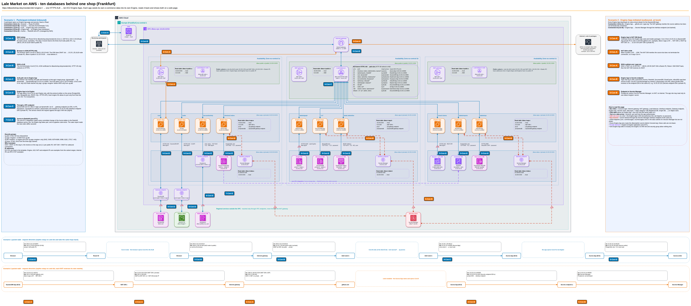

# AWS Database Workshop - Katılımcı Rehberi

Bu rehberle, eğitmenin CloudFormation ile tek adımda kurduğu ortamın **aynısını** AWS Console'dan kendiniz kurarsınız.
Bütün adlar, CIDR blokları, portlar ve boyutlar `cloudformation/workshop.yaml` ile aynıdır.

Sonuçta **Lale Market** adlı bir e-ticaret sitesi çalışır. Sitenin her bölümü farklı bir AWS veritabanını kullanır:
arama OpenSearch'ü, sepet DynamoDB'yi, ödeme Aurora'yı kullanır. Sitenin sağındaki **Behind the scenes** paneli,
her tıklamada hangi veritabanına hangi sorgunun gittiğini gösterir.

## Nasıl ilerlenir

1. **Modül 0'ı** baştan sona yapın. Bu modül zorunludur: ağı, endpoint'leri, ALB'yi, sertifikayı ve DNS kaydını kurar.
2. Sonra engine modüllerini yapın. Her modül tek bir engine'i ve onun web uygulamasını (Engine App) kurar.
3. Modülleri istediğiniz sırayla yapabilirsiniz. Tek kural: **önce Modül 8'i (DocumentDB) yapın.** Sitenin ana sayfası DocumentDB'dedir.
4. Her modülün sonunda bir **Doğrulama** bölümü vardır. Oradaki ekran çalışıyorsa modül tamamdır.
5. İşiniz bitince **Temizlik** bölümünü uygulayın. Aksi halde ücretlendirme devam eder.

| Modül | Engine | Veri tipi, kategori | Sitedeki bölüm | Süre (bekleme dahil) |
|---|---|---|---|---|
| [0](00-ortak-altyapi.md) | Ortak altyapı | - | - | 40 dk |
| [8](08-docdb.md) | DocumentDB | Semi-structured, Document | Ana sayfa, kategori, ürün sayfası, Admin Console | 20 dk |
| [1](01-aurora.md) | Aurora PostgreSQL Serverless v2 | Structured, Relational | Ödeme, siparişlerim, sipariş raporu | 20 dk |
| [2](02-redshift.md) | Redshift Serverless | Structured, Columnar | Satış raporları (zero-ETL ile canlı) | 25 dk |
| [3](03-dynamodb.md) | DynamoDB | Semi-structured, Key-value | Sepet | 10 dk |
| [4](04-elasticache.md) | ElastiCache Serverless (Valkey) | Semi-structured, In-memory | Flaş indirim, canlı liderlik tablosu | 15 dk |
| [5](05-keyspaces.md) | Keyspaces | Semi-structured, Wide column | Aktivite geçmişi | 10 dk |
| [6](06-influxdb.md) | Timestream for InfluxDB | Semi-structured, Time-series | Operasyon ekranı | 25 dk |
| [7](07-neptune.md) | Neptune Serverless | Semi-structured, Graph | Öneriler, müşteri grafı | 25 dk |
| [9](09-s3.md) | S3 | Unstructured, Blob | Ürün görselleri, satıcı paneli | 10 dk |
| [10](10-opensearch.md) | OpenSearch Service | Unstructured, Text search + Geo | Arama, mağaza bulucu | 30 dk |
| [T](99-temizlik.md) | Temizlik | - | - | 20 dk |

Bazı engine'lerin oluşması uzun sürer: OpenSearch, Neptune, DocumentDB, InfluxDB ve Aurora.
Oluşturmayı başlattıktan sonra beklemeyin. Aynı modülün IAM role ve security group adımlarına geçin.

## Ön koşullar

- **Region:** Europe (Frankfurt) `eu-central-1`. Konsolun sağ üstünden seçin. Bütün modüller bu region'dadır.
- Yönetici yetkisi (AdministratorAccess) olan bir IAM kullanıcısı veya rolü.
- Route 53'te public bir hosted zone. Workshop hesabında bu zone `tdsynnexlab.link`'tir.
  Kendi hesabınızda kendi alan adınızı kullanın ve rehberdeki `dbworkshop.tdsynnexlab.link` değerini ona göre değiştirin.
- Hesapta en az 3 boş Elastic IP kotası ve 1 boş VPC kotası.

## Ortak değerler

| Ad | Değer |
|---|---|
| İsim öneki | `dbws` |
| VPC CIDR | `10.20.0.0/16` |
| Public subnet'ler | `10.20.0.0/24` (a), `10.20.1.0/24` (b), `10.20.2.0/24` (c) |
| App subnet'leri | `10.20.10.0/24` (a), `10.20.11.0/24` (b), `10.20.12.0/24` (c) |
| Data subnet'leri | `10.20.20.0/24` (a), `10.20.21.0/24` (b), `10.20.22.0/24` (c) |
| Alan adı | `dbworkshop.tdsynnexlab.link` |
| Engine App kod deposu | `https://github.com/sametcntrk/aws-database-workshop.git` (dal `main`) |
| Engine App AMI | Amazon Linux 2023 (arm64) |
| Engine App instance tipi | `t4g.medium` |

Her Engine App sabit bir private IP alır ve ALB onu kendi yollarına göre çağırır:

| Engine App | AZ ve subnet | Sabit private IP | ALB yolları | Öncelik |
|---|---|---|---|---|
| Aurora | a, `dbws-app-a` | `10.20.10.14` | `/checkout`, `/orders`, `/admin/orders`, `/aurora/*` | 10 |
| Redshift | c, `dbws-app-c` | `10.20.12.12` | `/admin/reports`, `/redshift/*` | 20 |
| DynamoDB | a, `dbws-app-a` | `10.20.10.11` | `/cart`, `/dynamodb/*` | 30 |
| ElastiCache | b, `dbws-app-b` | `10.20.11.13` | `/deals`, `/admin/live`, `/elasticache/*` | 40 |
| Keyspaces | a, `dbws-app-a` | `10.20.10.13` | `/account/activity`, `/keyspaces/*` | 50 |
| InfluxDB | c, `dbws-app-c` | `10.20.12.13` | `/admin/ops`, `/influxdb/*` | 60 |
| Neptune | b, `dbws-app-b` | `10.20.11.11` | `/admin/graph`, `/neptune/*` | 70 |
| DocumentDB | b, `dbws-app-b` | `10.20.11.12` | `/docdb/*` ve **varsayılan kural** (`/`, `/c/*`, `/p/*`, `/admin`) | 80 |
| S3 | a, `dbws-app-a` | `10.20.10.12` | `/seller`, `/s3/*` | 90 |
| OpenSearch | c, `dbws-app-c` | `10.20.12.11` | `/search`, `/stores`, `/opensearch/*` | 100 |

Terimlerin anlamı için [GLOSSARY.md](../GLOSSARY.md) dosyasına bakın.
